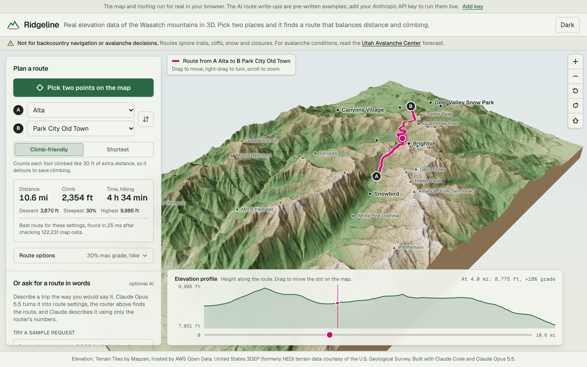
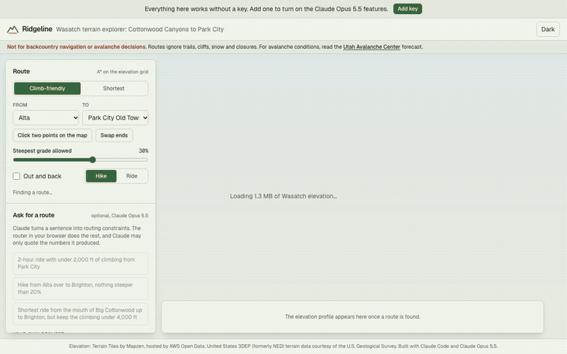
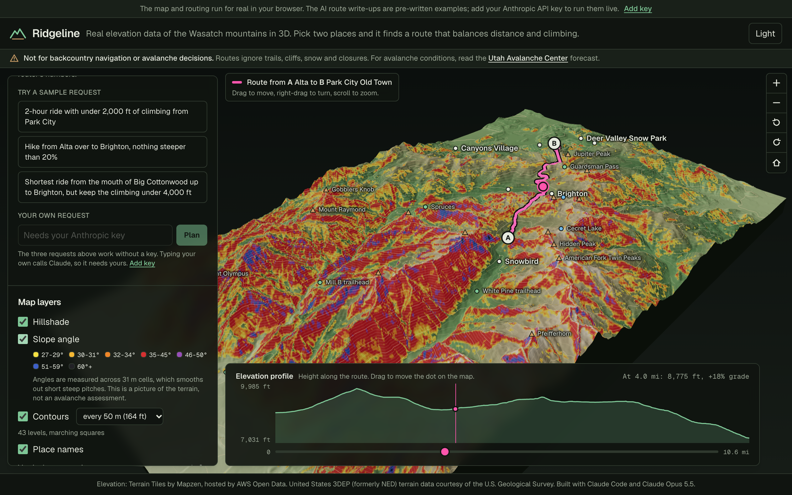
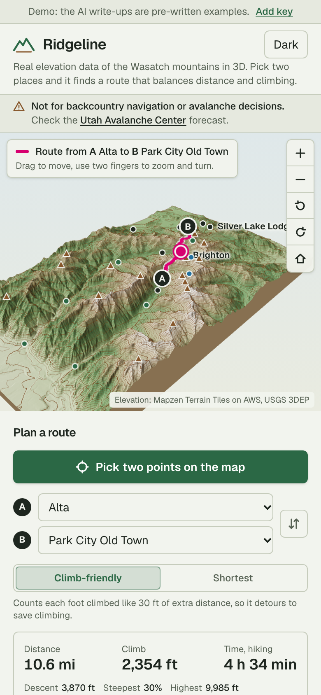
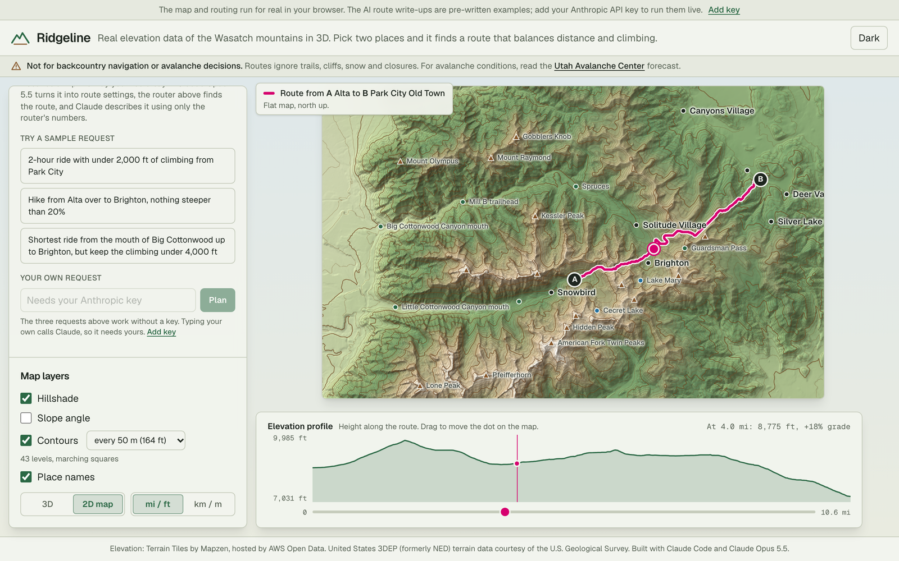
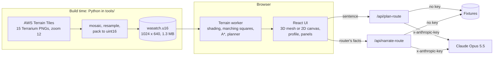

# Ridgeline

Real elevation data of Utah's Wasatch mountains in 3D: pick two places and it finds a route that balances distance against climbing.

[](https://github.com/davezagin-max/ridgeline/actions/workflows/ci.yml)
[](LICENSE)
[](#run-locally)



_The first screen: real terrain between Salt Lake City and Park City, with a route from Alta (A) to Park City (B) already drawn, its distance, climb and time on the left, and its elevation profile below._

## What it does

- **Shows real mountains in 3D.** About 640 km² (250 sq mi) of the central Wasatch, built from U.S. Geological Survey elevation data, with contour lines and shading. Drag to move around, scroll to zoom.
- **Finds a route between any two places.** Click two points on the map, or choose from 32 named resorts, peaks, trailheads and lakes. In milliseconds, right in the browser, it finds the route that best balances distance against climbing and shows its distance, climb, estimated time and elevation profile. A switch shows the plain shortest line instead.
- **Takes a request in plain English (optional AI).** "2-hour ride with under 2,000 ft of climbing from Park City": Claude turns the sentence into route settings, the router finds the route, and Claude describes it using only the router's numbers.

> **Not for backcountry navigation or avalanche decisions.** Routes ignore trails, cliffs, snow, closures and land ownership, and the slope shading comes from 31 m data. For avalanche conditions read the [Utah Avalanche Center](https://utahavalanchecenter.org) forecast. The same notice is pinned to the top of the app.

## Try it in 10 seconds

The live demo is coming soon. This is what it does from the first screen: press **Pick two points on the map**, click a start and an end, and the route, its numbers and its elevation profile appear straight away. **Shortest** shows the most direct line instead, and one click on a sample request shows the AI planner.



To run it yourself (no key and no sign-up needed), see [Run locally](#run-locally): `pnpm install && pnpm dev`, then open http://localhost:3190.

The map, contours, routing and profile are real and need no key at all. The optional "Or ask for a route in words" box has three sample requests that work without one; typing your own needs your Anthropic key, added in the app.

The AI write-ups in this commit are hand-written examples, not model runs, and the app labels them that way wherever they appear. `pnpm record` replaces them with real Claude Opus 5.5 runs once there is an API key.

| Asking for a route in words (sample request)                                                     | Slope-angle shading, dark theme                                        |
| ------------------------------------------------------------------------------------------------ | ---------------------------------------------------------------------- |
|  |  |

| Phone                                           | 2D map (also the no-WebGL fallback)                       |
| ----------------------------------------------- | --------------------------------------------------------- |
|  |  |

## Why it's interesting

- **The router's promises are proved, then tested.** Routing is A\* over the heightmap as an 8-connected grid, with cost = 3D distance + a penalty per metre climbed + a smaller one for steep descents, and a hard maximum grade. The heuristic (grid distance combined with the height difference, plus the climb that cannot be avoided) never overestimates and never drops faster than a step costs, so the first route found is optimal. "Climb-friendly" and "shortest" differ in one weight only, which makes "climb-friendly never climbs more" a two-line theorem rather than a hope. Tests check optimality against an independent Bellman-Ford solver, check the heuristic on every node of small grids, and check the theorem on random terrain and on the real map.
- **A climb limit without an NP-hard search.** "Keep it under 2,000 ft of climbing" is a cap on a path-wide total, which shortest-path search cannot take directly. The planner uses Lagrangian relaxation instead: it turns the climb weight up a short ladder until the cheapest route fits. Because raising the weight can never add climb, the first weight that fits is the least-distorted answer. A "loop" request becomes an out-and-back chosen from a single exhaustive search that prices every landmark at once. At the default 30% grade limit that search settles 625,310 of the map's 655,360 cells in 80 to 105 ms (five runs in Node on the development Mac).
- **The model never supplies a number.** Claude's only jobs are to turn a sentence into constraints and to write three sentences about a route that code has already computed. It copies "2,000 ft" as a number and a unit; code converts it. Its narration is accepted only if every numeral in it appears in the router's own formatted facts and it states the distance and total climb exactly as given; otherwise it gets one rewrite, and after that code writes the summary and the app says so.

## Architecture



- **Data.** `tools/terrain` downloads 15 elevation tiles once, stitches them, resamples to a 1024 x 640 grid that is regular in longitude and latitude (about 31.4 m per cell), and stores it as 16-bit integers in 0.1 m steps. The 1.3 MB result is committed, so the site has no data backend.
- **Geometry** lives in pure TypeScript modules under `lib/terrain` that run unchanged in the browser, the worker and Node tests: slope and aspect from central differences in real metres, hillshade, marching squares, A\*, ray picking.
- **One Web Worker** owns the heightmap and does the heavy work. It returns typed arrays that are transferred, not copied.
- **Rendering.** Hillshade, elevation tint and slope bands are baked into one RGBA texture. The 3D view (react-three-fiber, loaded with `next/dynamic` so three.js stays out of the first load) puts it on a single mesh; the 2D view draws the same pixels on a canvas, so the two can never disagree. Contours are joined polylines drawn as line segments. Clicking the terrain intersects the view ray with the heightfield directly instead of testing 326,000 triangles.
- **Contours** are joined by edge identity, not by comparing coordinates: the crossing on a grid edge is computed once from that edge's two samples, so neighbouring cells agree on it exactly and lines close without a tolerance. Saddle cells are resolved by the cell-centre value.
- **Landmarks** (32 resorts, peaks, passes, trailheads and lakes) were entered by hand and are checked by a test: every peak must sit on a local summit of the heightmap, and every published elevation must agree with the terrain under it to within 25 m.

### Elevation data and credit

Elevation: [Terrain Tiles](https://registry.opendata.aws/terrain-tiles/) by Mapzen, hosted by AWS Open Data. United States 3DEP (formerly NED) terrain data courtesy of the U.S. Geological Survey.

The dataset's licence field points to the project's [attribution page](https://github.com/tilezen/joerd/blob/master/docs/attribution.md), which was read on 11 October 2026. It describes 3DEP, the source inside the United States, as public domain with a request for credit. What was done to the data (mosaic, bilinear resample, 0.1 m quantisation) and the terms as read are recorded in [`tools/README.md`](tools/README.md).

## How it uses Claude Opus 5.5

Claude is optional here. It sits at the two ends of the route planner and never in the middle.

| Feature                                                              | Why                                                                                                                                                                                                                         |
| -------------------------------------------------------------------- | --------------------------------------------------------------------------------------------------------------------------------------------------------------------------------------------------------------------------- |
| One strict tool, `set_route_constraints`, with landmark ids as enums | Tool inputs are guaranteed to match the schema, so a start can only be a place that exists on the map.                                                                                                                      |
| Tool choice left on auto, and the call is checked                    | Forced tool use is not available, so the prompt says when the tool applies and code verifies the call happened. No call, or a call that fails validation, gets one correction; after that the visitor gets a plain message. |
| Units copied, not converted                                          | The tool takes the climb limit as written plus its unit. Feet become metres in code, where it can be tested.                                                                                                                |
| Structured output for the narration, checked numeral by numeral      | The model is given the router's figures as formatted strings and may only quote them. A figure the router did not produce fails the check.                                                                                  |
| `low` effort on both calls                                           | Both are short extraction and writing tasks, so depth is kept down to keep them quick and cheap.                                                                                                                            |
| Request and facts wrapped as tagged, untrusted data                  | The system prompt says tagged content is data. The facts come from the visitor's browser, so they get the same treatment as the sentence.                                                                                   |
| Refusals returned as results                                         | A declined request shows a clear message next to what it cost, not a generic error.                                                                                                                                         |
| Cached system prompt on the constraints call                         | The tool definition and landmark table are identical on every request: about 4,800 characters, an estimated 1,100 tokens (not yet measured against the API).                                                                |

**Your key stays yours.** The app is bring-your-own-key. The key lives in your browser tab's memory (optionally `sessionStorage`), travels in an `x-anthropic-key` header to this app's own API route, and is used for that one request. The server never stores or logs it. Each live action shows its token count and cost. Cancelling, or starting another request, aborts the call in flight and stops the chain, so an abandoned request makes no further model calls.

## Run locally

```bash
pnpm install
pnpm dev
```

Open http://localhost:3190. Everything except typing your own request works with no key.

To rebuild the heightmap from the source tiles: `cd tools && uv sync && uv run python -m terrain.build`.

## Tests & quality

```bash
pnpm check                                  # lint, typecheck, unit tests, production build
cd tools && uv run pytest -q                # Python preprocessing tests
```

198 Vitest tests and 24 pytest tests (plus 3 live smoke tests that are skipped until there is a key). What they cover:

- **Slope, aspect, hillshade:** a tilted plane recovers its angle, cell size in metres matters (the same grid is 45 degrees at 1 m cells and 0.6 degrees at 100 m), non-square cells, one-sided differences on edges, compass conventions.
- **Marching squares:** single-cell cases with exact interpolation, both saddle resolutions, a hill becoming one closed loop per level, two hills merging below their pass and splitting above it, lines that leave the grid, samples exactly on the level, and every vertex lying on the contour's elevation.
- **A\*:** hand-built grids with known costs, the max-grade wall (through the only gap, and "no route" when there is none), agreement with an independent Bellman-Ford solver across random terrain and option sets, heuristic admissibility and consistency checked node by node, and climb-friendly never out-climbing shortest.
- **Planner and narration check:** the climb-weight ladder, out-and-back selection compared against every alternative, unit conversion, rejection of invented, rounded or missing figures.
- **Claude paths with a fake client:** request shape (explicit effort, strict tool, no forced tool choice), the retry and correction turns appended to the history unchanged, refusals, cancellation stopping the second call, the fallback summary.
- **Fixtures:** every fixture is run through the real validators and the real router on the committed heightmap, and `fixtures/presets.json` must carry exactly the facts the router produces.
- **Smoke test:** each sample request goes route handler to planner to route handler in demo mode.
- **Python:** tile maths, Terrarium decoding, resampling a known plane exactly, the on-disk format round trip, tile caching, and rejection of a non-PNG download.

The UI was checked in headless Chromium at 1280, 390 and 360 px wide, in both themes, with WebGL disabled, and with the API routes stubbed to exercise the live states.

CI runs the same checks plus a gitleaks secret scan on every push.

## Tradeoffs, limitations, next steps

- **It routes over terrain, not trails.** The graph is the elevation grid. It knows nothing about trails, roads, cliffs smaller than a cell, vegetation, private land or closures. Real trail routing needs a trail network; adding an OpenStreetMap graph is the obvious next step.
- **The grade limit is stricter on a grid than on the ground.** Steps go in 8 directions only, so a hillside that a real trail would cross at a gentle angle can be impassable here if none of the 8 directions is gentle enough. That is why some pairs report "no route" at limits a trail builder could meet.
- **Slope angles are smoothed.** They are measured across 31 m cells, which hides short steep pitches. The shading is a picture of the terrain, not an avalanche assessment.
- **The pace model is Naismith's rule** (flat speed plus an hour per 600 m climbed), with descents counted at flat speed. It is for comparing routes, not scheduling a day.
- **The climb cap is met by a ladder of weights (the mode's own, then 30, 60, 120, 240).** The route returned is optimal for the weight it was found with. It is not guaranteed to be the shortest of all routes under the cap, and a cap that only a weight between two rungs would satisfy is reported as not met.
- **Loops are out-and-backs to a landmark,** not true circuits.
- **The narration check covers figures, not the words around them.** It guarantees no number was invented; it cannot stop the model attaching a correct number to the wrong noun. The prompt forbids invented trail names and conditions, but that part is not verified by code.
- **The live Claude path has not been run against the real API yet.** There is no key in this project so far. The path is complete and tested with a fake client, and the sample requests replay hand-written fixtures that the tests hold to the router's real numbers.
- **Recording order matters.** `pnpm record` records the constraints, regenerates the facts in `fixtures/presets.json` from them (`pnpm facts`), then records the narrations.
- **Landmarks are map labels, not survey points.** Their coordinates and published elevations were typed in by hand from commonly listed figures and cross-checked only against the heightmap, not against a gazetteer.
- **Not yet tried** on a physical phone, in Safari or Firefox, or with a screen reader. Labels are not hidden when a ridge is in front of them.
- Rate limiting is in memory per server instance: enough to blunt abuse of a demo, not a global quota.

---

Elevation: Terrain Tiles by Mapzen, hosted by AWS Open Data. United States 3DEP (formerly NED) terrain data courtesy of the U.S. Geological Survey.

Built with Claude Code and Claude Opus 5.5.
